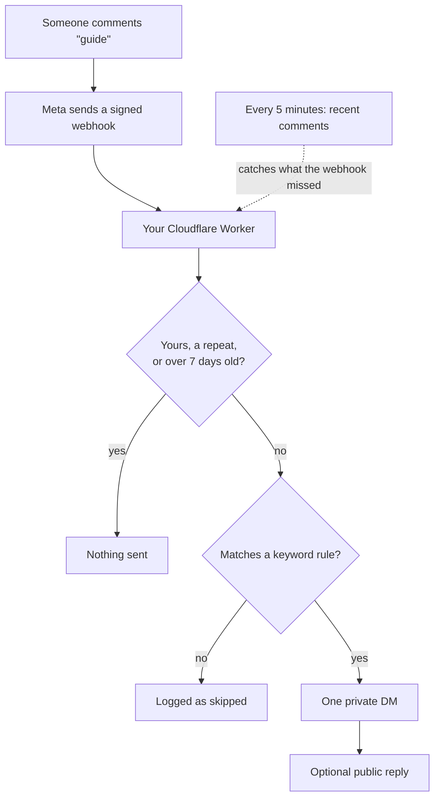

Comment to DM is self-hosted Instagram automation: one Cloudflare Worker and one D1 database on your own Cloudflare account, on the free plan. You write keyword rules in its admin panel. When someone comments **guide** on your reel, the Worker answers with one private message carrying your link, and a public reply under the comment if you want one.

It uses Meta's official Graph API through Instagram Login. There is no scraping and no browser automation, and the Worker never sees your Instagram password. The access token Instagram issues is encrypted with a key that lives in your Cloudflare account and nowhere else.

## How a comment becomes a DM

1. Someone comments on a post or reel of an Instagram account you connected.
2. Meta POSTs a signed notification to `/webhook` on your Worker. The Worker checks the signature, logs the event, answers `200` straight away and does the rest in the background.
3. It drops your own comments, comments it has already answered, and comments older than seven days.
4. It matches the comment against your rules: keywords as whole words or anywhere in the text, depending on the rule, or every comment on one post for a giveaway. Keyword rules for that post come first, then keyword rules for every post, then reply-to-everyone rules, and the oldest matching rule in each group wins.
5. It sends one private reply, which lands in the commenter's DMs. Once that has gone through, it posts your public reply under the comment, if the rule has one.

## Two delivery paths

The webhook is the fast path. Instagram also quietly drops webhooks for collapsed and low-signal comments, so every five minutes the Worker asks Instagram for recent comments and answers anything the webhook missed.

| | The webhook | The poll |
|---|---|---|
| Speed | About two seconds | Up to five minutes |
| How it starts | Meta POSTs to `/webhook` | The Worker asks Instagram for recent comments |
| Needs the Meta app to be Live | Yes | No |
| Sees comments hidden by Hidden Words | No | No |
| Covers old posts | Yes | Only the 3 most recent posts, last 72 hours |

Both paths share the same rule matching and the same duplicate protection, so a comment is never answered twice. If DMs arrive but take five minutes, the webhook isn't being delivered: see [Troubleshooting](/troubleshooting#the-two-delivery-paths).

## What it's made of

| | |
|---|---|
| Runtime | One Cloudflare Worker |
| Database | Cloudflare D1 (SQLite), five tables |
| Framework | [Hono](https://hono.dev), server-rendered HTML |
| Dependencies | One at runtime (`hono`). Web Crypto does the hashing, HMAC and AES. |
| Client-side JavaScript | None |
| Build step | None |

The admin panel lives at a secret URL on your Worker. You connect Instagram accounts there, write keyword rules, test them, and read a log of every send.

## What you need

- An Instagram **professional** account (Creator or Business). Personal accounts can't use the Instagram API. Switch in the Instagram app under Settings → Account type and tools.
- A free [Cloudflare](https://dash.cloudflare.com/sign-up) account.
- A free [Meta for Developers](https://developers.facebook.com/) account, signed in with the Facebook login that manages that Instagram account.
- [Node.js](https://nodejs.org/) 20 or newer, to run the setup script and `wrangler`.

## Instagram's rules

These are enforced by Meta, not by this project.

- **One private message per comment, ever.** There's no follow-up unless the person replies to you first, so put everything they need in that one message.
- **Your own comments are ignored.** Meta notifies you about them, and acting on one would DM yourself and use up that comment's single reply.
- **Comments older than 7 days** can't receive a private reply. They're logged as skipped.
- **Tokens expire after 60 days.** A nightly job refreshes them. If it misses long enough, the account needs a 20-second reconnect.
- **A Meta app in Development mode receives no real comments.** Meta only delivers its dashboard Test button until you publish the app. Publishing doesn't need App Review while only your own accounts connect.
- **Hidden Words removes comments before the API sees them.** Turn the filter off while you test.
- **A DM to someone who doesn't follow you** lands in their Message requests.

## Where to go next

<CardGroup cols={2}>
  <Card title="Self-setup guide" href="/setup">
    Deploy to Cloudflare and click through Meta's dashboard yourself, screen by screen.
  </Card>
  <Card title="Agent setup guide" href="/agent-setup">
    Have Claude Code and Claude in Chrome do the clicking. You keep the logins and the secrets.
  </Card>
  <Card title="Using it" href="/using">
    Rules, keywords, testing a rule without messaging anyone, and reading the logs.
  </Card>
  <Card title="Troubleshooting" href="/troubleshooting">
    Symptom first. Start here when a comment gets no DM.
  </Card>
</CardGroup>
